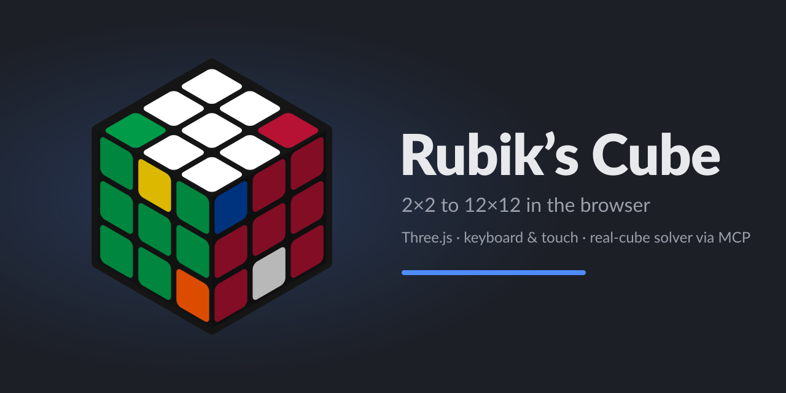

# Rubik's Cube



A configurable NxN (2×2 to 12×12) cube you can solve in the browser. It uses plain ES modules and Three.js from a CDN, with no build step.

## Dependencies

The page has nothing to install: the root `package.json` has no dependencies and there is no build step. The optional real-cube server (`server/`) has its own dependencies, listed below.

| Dependency | Version | Used for | Loaded from |
|---|---|---|---|
| [Three.js](https://threejs.org/) | 0.187.0 (pinned) | Rendering (`js/cube.js`, `js/main.js`) | jsDelivr CDN via the import map in `index.html` |
| Three.js addon `OrbitControls` | 0.187.0 | Camera orbit (`js/main.js`) | `three/addons/controls/OrbitControls.js` |
| Three.js addon `RoundedBoxGeometry` | 0.187.0 | Rounded cubies (`js/cube.js`) | `three/addons/geometries/RoundedBoxGeometry.js` |

To upgrade Three.js, change the version in both import map entries in `index.html`.

Server (`server/package.json`, pinned, installed with `npm ci` or by the Docker build):

| Dependency | Version | Used for |
|---|---|---|
| [@modelcontextprotocol/sdk](https://www.npmjs.com/package/@modelcontextprotocol/sdk) | 1.32.2 | MCP Streamable HTTP endpoint |
| [zod](https://www.npmjs.com/package/zod) | 4.6.7 | MCP tool input schemas |
| [cubejs](https://github.com/ldez/cubejs) | 1.3.2, vendored in `server/vendor/cubejs` (MIT) | Kociemba two-phase solver and its move/pruning tables (also used by the optimal short search). Vendored because its npm package needlessly depends on `npm@6`, which pulls in about 27 MB of packages with known CVEs. Patched to take a deadline (it has no timeout option); see `server/vendor/cubejs/PATCHES.md`. |
| Docker image `node` | 26.13.1-alpine | Container runtime |

Runtime requirements:

- **Browser** with ES modules, import maps and WebGL (any current Chrome, Edge, Firefox or Safari). It needs internet access to reach the CDN.
- **Static file server**, because ES modules don't load over `file://`. Any server works.

Development tools (not installed by the project):

- **Node.js** with the built-in `node:test` runner, for `npm test`. Tested on Node 26.
- **[serve](https://www.npmjs.com/package/serve)**, fetched on demand by `npx` for `npm start`. Python's `http.server` works too.

## Deploy

Static only: copy the files to any static host. `.htaccess` (Apache) returns 404 for dotfiles (`.git`, `.env`), `server/`, `data/` and the build/package files, so a checkout can be served directly.

With real-cube mode: run the Docker container (see below) from a checkout outside the web root, and put HTTPS in front of it.

## Run

ES modules don't load over `file://`, so serve the folder:

```sh
npm start              # npx serve .
# or: python -m http.server
```

## Features

- Cube size, turn speed, scramble length, colour scheme, sticker/body/background colours and key bindings, all saved in localStorage
- Colour scheme presets: **My cube** (the default: Japanese scheme, white top, yellow front, orange right), Western / American (white top or yellow top), Japanese (white top, green front), or a custom one set face by face. Every preset is a rotation of a real scheme, never a mirror image, and tests check this. Save/load follows the scheme. In real-cube mode, Paint → Clear starts from a solved cube in this scheme. In real-cube mode, picking a preset while the cube is solved opens Paint with a solved cube in that scheme, ready to send. Claude still reads your real cube's scheme from its centres
- Drag a sticker to turn its layer; drag the background to orbit
- Keyboard notation: `R L U D F B M E S x y z`, Shift for counter-clockwise, a number prefix for inner layers (`3` then `R` → `3R`)
- Text input for algorithms (`R U R' U'`, `2Rw`, `r`, `M2`, …)
- Timer and move counter that start after a scramble and stop when the cube is solved
- Undo, and an auto-Solve that plays back the inverse of the scramble plus your moves
- The cube, its move history, move count and timer survive a page reload (saved in localStorage), and so does real-cube mode
- Save / load the sticker state (any size) as text, a `#state=…` link or a JSON file. Stickers are written as colour letters `W Y R O G B` in Kociemba facelet order, so a 3×3 is the same 54 letters the MCP `get_cube`/`set_cube` tools use; other sizes are written `N:letters`. Older exports in face letters `U R F D L B` still load. Solve can't undo an imported cube, because its move history isn't known

## Real-cube mode + MCP server

`server/` is a small Node service that serves the page and also:

- shares one physical 3×3's state between the page (Paint → **Send to Claude**, then a live view over SSE) and Claude, which reaches it through an MCP endpoint
- solves it in as few moves as it can find within a time budget:
  1. an IDA* search for an exact **optimal** solution (half-turn metric). It handles cubes up to about 10 moves from solved in milliseconds and stops after `SHORT_SEARCH_MS` (default 300).
  2. If that runs out, Kociemba's two-phase algorithm (vendored [cubejs](https://github.com/ldez/cubejs), MIT, ≤22 moves), asked again for one move fewer each time it succeeds, until `SOLVE_BUDGET_MS` (default 2000) is used up.

  The `solve` tool says either "optimal" or "best found in N ms". Set the budgets in `.env`. A solve blocks the server for at most the budget.

Any colour scheme works (Western, Japanese with white opposite blue, or custom). The state is stored as sticker colours (`W Y R O G B`), and the six centre stickers decide which colour belongs to which face. Validation, the solver and every instruction Claude gets (how to hold the cube, the diagram, move explanations) are worked out from those centres. The page and MCP share one state store.

- **Painting is saved** in the browser as you go, so a reload (or closing Paint) keeps it. It is only dropped by **Clear**, a successful **Send to Claude**, or choosing to discard your edits.
- **Live while painting:** moves Claude applies animate on the painted cube too, so your edits turn with their layers. Only a full replacement (`set_cube`, `reset_cube`) asks before discarding edits.
- **Moves and undo on the page:** in real-cube mode, turns you make on the page (drag, keyboard, Apply moves) are recorded as moves on your real cube, exactly like Claude's `apply_moves`. **Done: R2** records the plan's current step in one tap. **Undo** reverts the last recorded move or batch, yours or Claude's, together with the plan as it was. The plan follows the cube's state, so a half turn done as two quarter turns still counts. Setting a new state (Send, `set_cube`, `reset_cube`) starts a fresh undo history.
- **Next move:** while there is a plan, an arrow on the 3D cube shows the current step. Quarter turns get one head, half turns two heads and a ×2 label. When the turning face is hidden (back, bottom, left), the arrow is drawn on a visible neighbouring face instead, showing which way that layer's stickers move.
- **Hold:** in real-cube mode the page shows the same "Hold:" line Claude gets. The page draws the cube that way round: top on top, the face you hold towards you at the front, right on the right.
- **Mirrored centres are rejected:** centres that are a mirror image of a known scheme (Western, Japanese) get a clear message, e.g. "red and orange look swapped: is the cube mirrored?".
- **Plain-language hints** for every plan move, on the page and in the MCP output, relative to how you hold the cube (e.g. `U` = "top row facing you moves left", `B` = "top of the back layer moves to your left"). Tests check each hint and arrow against the cube model.

MCP tools: `get_cube`, `set_cube`, `solve`, `apply_moves`, `reset_cube`. The endpoint is `/mcp` and requires an `Authorization: Bearer <MCP_TOKEN>` header.

```sh
echo "MCP_TOKEN=$(openssl rand -hex 32)" > .env
docker compose up -d --build        # http://localhost:8095 (CUBE_PORT to change)
```

Real-cube mode is only offered when the page is served by this server.

## Test

```sh
(cd server && npm ci) && npm test
```
